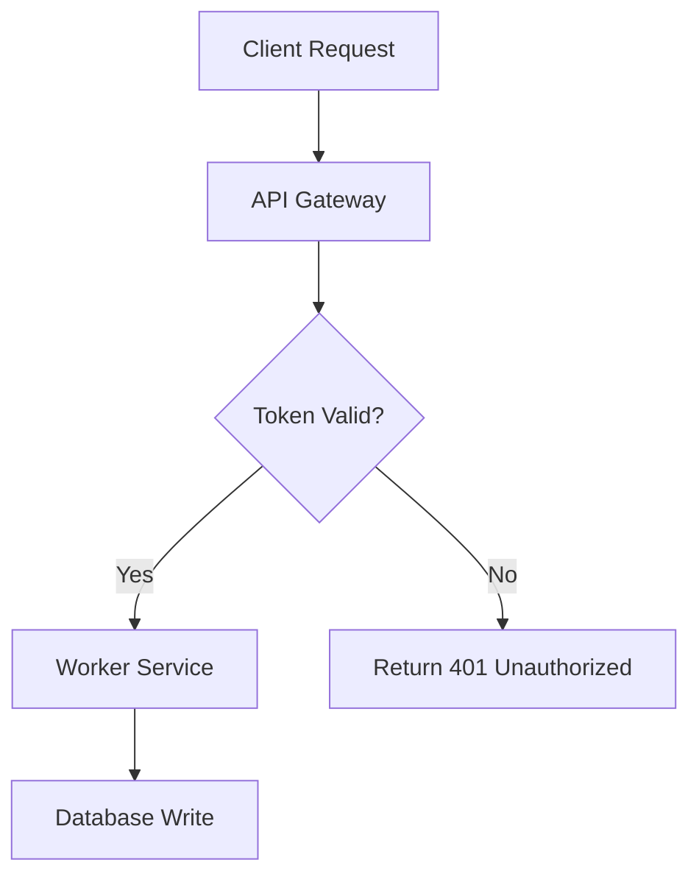

# ASD-STE100: Simplified Technical English & Karpathy 80% Pragmatic Mode

ASD-STE100 is an international controlled-language specification maintained by the Aerospace and Defence Industries Association of Europe (ASD). It was created to stop maintenance personnel from misreading technical instructions, where ambiguous wording can lead to catastrophic hardware failure.

This capability applies the exact same discipline to **autonomous AI agents, prompt engineering, tool contracts, and technical documentation**. When language models parse instructions, tool schemas, or system prompts without a human to resolve ambiguity, unconstrained natural language produces hallucinations, invalid parameter choices, and flawed assumptions.

In addition to the aerospace standard (Issue 9, January 2025), this capability incorporates Andrej Karpathy's **80% Pragmatic Mode**, which relaxes domain-specific vocabulary restrictions while preserving the cognitive parseability rules that maximize comprehension speed and accuracy.

---

## 1. When to Use This Capability

Activate this capability when:
- An AI agent's instructions, tool descriptions, or error messages read as dense, passive, or ambiguous.
- Writing inter-agent protocol messages, prompt templates, or function call parameters where misinterpretation causes failures.
- Drafting architecture decision records (ADRs), runbooks, API documentation, or technical onboarding guides that require immediate cognitive clarity.
- The user requests explanations in **ASD-STE100**, **Simplified Technical English**, **"80% STE"**, or **"Karpathy-style writing"**.
- Summarizing complex sessions, decisions, or architectural reviews into structured records.
- Linting or auditing existing documentation for passive voice, bloated sentences, unapproved synonyms, or semicolons.

---

## 2. Operational Modes: Strict 100% vs. Karpathy 80% Pragmatic

| Rule Dimension | Strict Mode (100% ASD-STE100) | 80% Pragmatic Mode (Karpathy) [Default] |
| :--- | :--- | :--- |
| **Primary Domain** | Safety-critical systems, tool schemas, agent protocols | Software engineering, systems design, architecture docs |
| **Sentence Length** | Procedural: maximum 20 words.<br>Descriptive: maximum 25 words. | Target 15 to 22 words. Hard ceiling: 25 words. |
| **Voice** | Active voice mandatory. Passive allowed only in descriptive text when the agent is unknown. | Active voice prioritized; direct subject-verb-object structure. |
| **Thought Density** | Exactly 1 instruction or thought per sentence. | 1 primary idea per sentence. |
| **Vocabulary** | Restricted to approved base words plus declared technical nouns and verbs. | Plain controlled English; permits standard tech terminology (*API*, *container*, *latency*, *cache*). |
| **Noun Clusters** | Maximum 3 consecutive nouns. | Maximum 3 consecutive nouns. Break chains with prepositions. |
| **Punctuation** | Semicolons forbidden (Rule 8.1). No contractions. No Latin abbreviations (*e.g.*, *i.e.*). | Semicolons forbidden. Contractions and standard abbreviations tolerated. |
| **Paragraphs** | Maximum 6 sentences per paragraph. 1 topic per paragraph. | Maximum 6 sentences per paragraph. Topic sentence first. |
| **Modality Support** | Text tables and structured lists. | 4 Cognitive Modalities (Text, Mermaid, HTML, Video scripts). |

For detailed breakdowns of the underlying rules, see:
- [writing-rules.md](references/writing-rules.md): Complete guide to the 53 writing rules of Issue 9 across 9 sections.
- [karpathy-framework.md](references/karpathy-framework.md): 80% Pragmatic Mode and the 4 Cognitive Modalities.
- [verb-forms.md](references/verb-forms.md): Verb forms matrix and prohibited tenses.
- [approved-words.md](references/approved-words.md): Approved words, technical vocabulary, and prohibited buzzwords.

---

## 3. Anatomy of STE Sentences

### Procedural Sentence
Procedural sentences give direct instructions to an operator or agent.
- **Rule**: Maximum 20 words. Use the imperative verb form. Active voice.
- **Unapproved**: *"It is imperative that the operator ensures the hydraulic reservoir is replenished prior to commencing operation."* (16 words, 4 unapproved forms)
- **Approved STE**: *"Make sure that the hydraulic reservoir is full before you start the operation."* (13 words)
  - `Make sure`: Approved verb form (imperative command).
  - `hydraulic reservoir`: Approved technical name (2-word noun cluster).
  - `is full`: Descriptive state replacing unapproved "replenished".
  - `before`: Approved conjunction replacing "prior to".
  - `you start`: Direct active subject and verb.
  - `the operation`: Noun replacing unapproved verb "commencing".

### Descriptive Sentence
Descriptive sentences explain system states, operational conditions, or specifications.
- **Rule**: Maximum 25 words. Maximum 6 sentences per paragraph.
- **Unapproved**: *"The electrical supply unit functions in order to continually furnish high voltage power to the primary propulsion system while the activation mechanism remains in the enabled position."* (25 words, bloated nominalizations)
- **Approved STE**: *"The power unit supplies high-voltage power to the motor when the switch is on."* (14 words)

### Safety Instruction
Safety instructions protect human life, physical hardware, and production data.
- **WARNING**: Indicates a risk of injury or death to personnel.
- **CAUTION**: Indicates a risk of damage to equipment or data corruption.
- **Format**: First a clear, simple command. Then state the specific risk.
- **Example**:
  ```text
  WARNING: Do not touch the brake unit until it is cool. Hot parts can cause injury.
  CAUTION: Do not delete the database partition. Data loss will occur.
  ```

---

## 4. The Verb Forms Matrix

ASD-STE100 Section 3 strictly defines allowed verb tenses to prevent temporal ambiguity:

| Form | Example | Status | Rule Citation |
| :--- | :--- | :--- | :--- |
| **Command (Imperative)** | Close the valve. / Flush the cache. | Approved | Rule 3.1 |
| **Simple Present** | The valve closes. / The service starts. | Approved | Rule 3.2 |
| **Simple Past** | The valve closed. / The worker halted. | Approved | Rule 3.3 |
| **Simple Future** | The valve will close. / The job will execute. | Approved | Rule 3.4 |
| **Infinitive** | Turn the knob to close it. | Approved | Rule 3.5 |
| **Past Participle (as adjective)** | The closed valve prevents flow. | Approved | Rule 3.6 |
| **Progressive (-ing)** | The valve is closing. | NOT approved | Rule 3.7 |
| **Perfect (Compound)** | The valve has closed. | NOT approved | Rule 3.8 |
| **Passive (in procedures)** | The valve must be closed by the user. | NOT approved | Rule 3.9 |

> [!NOTE]
> The `-ing` form is permitted only as part of an established technical noun (for example: *landing gear*, *operating system*, *clustering algorithm*). It is never permitted as a active progressive verb form (*is running*, *was validating*).

---

## 5. Karpathy's 4 Cognitive Modalities

When explaining complex systems or workflows, apply the 4 modalities to optimize parseability:

### Modality 1: Pure Controlled Text
Direct, short sentences conforming to 80% STE. Used for README files, ADRs, PR descriptions, and runbooks.

### Modality 2: Mermaid Structural Diagrams
When an interaction involves 3 or more components, asynchronous handshakes, or branching logic, accompany the text with a standard Mermaid diagram:


### Modality 3: Interactive HTML Explainer Widgets
For state machines, distributed algorithms, or mathematical transforms, generate single-file self-contained HTML components featuring reactive sliders, step-by-step playback, or interactive state inspections.

### Modality 4: Video Storyboards & Animation Scripts
Produce scene-by-scene animation scripts (e.g., Manim / 3Blue1Brown style) with narration cues written in STE for clear pacing and algorithmic visualization.

---

## 6. Transformation Reference Table

| Non-STE / Bloated Prose | Strict 100% STE Rewrite | 80% Pragmatic Mode Rewrite |
| :--- | :--- | :--- |
| *In order to utilize the database, it is necessary that authentication be performed prior to commencing queries.* | You must log in before you send queries to the database. | Log in before you query the database. Authentication is required. |
| *The worker pool should be terminated subsequent to the completion of all scheduled tasks.* | Stop the worker pool after all tasks finish. | Stop the worker pool after all tasks finish. |
| *Make sure the system is properly configured with an adequate number of replicas.* | Configure the system with at least 3 replicas. | Configure the system with at least 3 replicas to prevent downtime. |
| *The data was transmitted across the network by the client agent.* | The client agent sent the data across the network. | The client agent sent the data across the network. |
| *We have performed an investigation into the issue and verified that no data loss has occurred.* | We investigated the issue. We confirmed that no data was lost. | We investigated the issue and found no data loss. |

---

## 7. Session Records Format

When asked to summarize a session, meeting, or architectural decision, output structured records adhering to this format:

```markdown
# Session Record: [Topic Name]

## Purpose
State the user requirement or system objective in 1 to 2 active sentences.

## Decisions
- State decision 1 and the exact technical reason.
- State decision 2 and the exact technical reason.

## Completed Work
1. Step one executed in chronological order.
2. Step two executed in chronological order.

## Open Items
- List remaining uncompleted tasks or unresolved blockers.
```

---

## 8. Offline Governance Tooling

This capability includes pure Python standard library tools located in `scripts/`:

### Deterministic Linter (`ste_lint.py`)
Run the linter on any markdown file or via standard input:
```bash
python3 scripts/ste_lint.py path/to/document.md
python3 scripts/ste_lint.py --mode strict path/to/procedure.md
echo "It is recommended to utilize the cache." | python3 scripts/ste_lint.py
python3 scripts/ste_lint.py --selftest
```

### Vocabulary Lookup Tool (`ste_lookup.py`)
Look up unapproved words and retrieve approved STE replacements:
```bash
python3 scripts/ste_lookup.py utilize
python3 scripts/ste_lookup.py "prior to"
python3 scripts/ste_lookup.py --all
```
