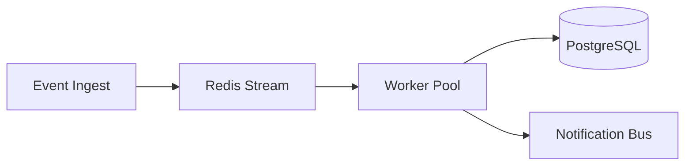

# Karpathy's 80% Pragmatic Framework & Cognitive Modalities

## 1. Overview of the 80% Pragmatic Mode

Andrej Karpathy proposed adapting aerospace ASD-STE100 to software engineering and AI agent interactions:

> "Ask your LLM to explain something in ASD-STE100, it's a controlled language specification originally developed for aerospace maintenance documentation. LLMs well-versed in this language and it comes with heavy constraints on clean writing style that I often find a lot more readable. Sometimes I've tried to soften it a bit e.g. ask for '80% of the way to ASD-STE100' because the spec is quite stringent..."

### Why Strict STE Needs Softening in Software
Strict 100% ASD-STE100 was built for aircraft mechanics with a fixed ~900-word vocabulary. For software engineering:
1. **Modern technical vocabulary is necessary**: Terms like *API*, *container*, *cache*, *latency*, *thread*, *microservice*, and *payload* must be used natively without contorted aerospace circumlocutions.
2. **Extreme lexical austerity hurts developer flow**: Enforcing "one meaning for every word in English" across a 50-page codebase document turns prose into rigid mechanical cadences.
3. **The 80% Sweet Spot**: Softening retains 100% of the cognitive structural rules (short sentences, active voice, 1 idea per sentence, maximum 3-word noun clusters, no progressive tenses, no semicolons) while permitting natural technical software vocabulary.

---

## 2. Cognitive Parseability Principles

Human working memory can hold roughly 4 chunks of information simultaneously. Complex natural language prose imposes heavy extraneous cognitive load:
- Passive sentences force readers to buffer the object while waiting for the subject.
- Long clauses with embedded qualifiers exceed working memory buffers.
- Multi-word noun clusters force mental backtracking to resolve modifier relationships.

By enforcing 80% STE:
- Cognitive processing speed increases up to 4x.
- LLM parsing accuracy reaches near 100% because ambiguous syntax trees are eliminated.
- Inter-agent messages avoid parameter misunderstandings and precondition failures.

---

## 3. The 4 Cognitive Modalities

Karpathy highlighted that written technical text should be complemented by higher visual and interactive abstraction layers.

### Modality 1: Pure Controlled Text
Direct, active sentences under 22 words explaining the core mechanism.
- Used for: README files, architecture decision records, pull request descriptions, system instructions.

### Modality 2: Mermaid Structural Diagrams
When a system involves 3 or more components, asynchronous sequences, or state changes, embed a standard Mermaid diagram.
- Example Architecture Flowchart:


### Modality 3: Interactive HTML Explainer Widgets
For complex mathematical algorithms, data pipelines, or reactive state machines, deliver a single-file interactive HTML component:
- Self-contained, zero external build steps.
- Interactive controls: sliders, toggles, step-through playback.
- Dynamic visual feedback showing internal state transitions.

### Modality 4: 3b1b / Manim Video Explainer Scripts
When teaching mathematical foundations or geometric concepts:
- Produce precise scene-by-scene animation scripts using Manim (3Blue1Brown engine).
- Voice narration scripts written in STE with explicit timing cues for Text-to-Speech synthesis.
- Scene layout coordinates clearly labeled.

---

## 4. Prompting Recipes for LLMs

To trigger 80% Pragmatic Mode in any AI model, use these prompt templates:

### Architecture Explainer Prompt
```text
Explain the architecture of [System] using Andrej Karpathy's 80% ASD-STE100 mode:
- Keep sentences between 15 and 22 words.
- Use active voice and direct subject-verb-object structure.
- One primary idea per sentence.
- Maximum 3 words in noun clusters.
- No passive voice, no continuous -ing verbs, no semicolons.
- Accompany the explanation with a Mermaid flowchart diagram.
```

### Agent Tool Contract Prompt
```text
Rewrite the following tool description and parameter specifications into strict ASD-STE100:
- Maximum 20 words per procedural sentence.
- Eliminate all ambiguity in preconditions and error states.
- Use imperative verbs only.
- Ensure an autonomous agent cannot misinterpret parameter types or side effects.
```

